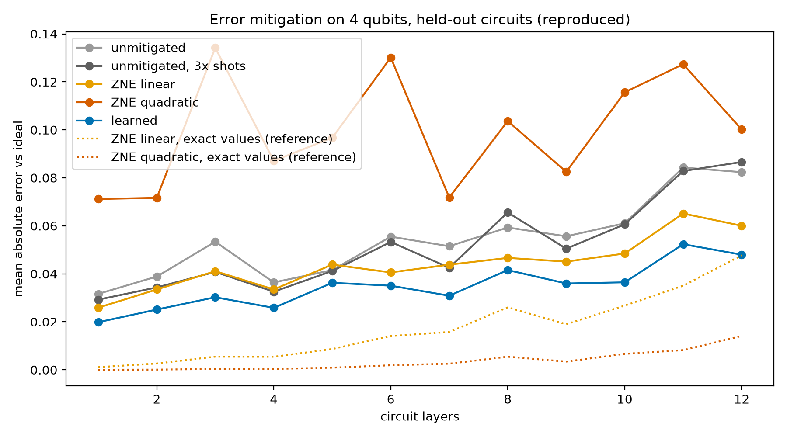

# TrustQEM

[](https://github.com/reddy-nithin/trustqem/actions/workflows/ci.yml)

**Error mitigation that knows when it's wrong.**

Quantum computers are noisy, and error mitigation tries to estimate what a circuit would have returned without
noise. Learned error mitigation (a model trained on noisy/ideal pairs) is accurate, but it returns a single number
with no error bar. When the hardware's noise drifts, as it does from day to day, that number quietly goes wrong.

This project:

1. puts conformal prediction intervals (error bars with a coverage guarantee) on learned error mitigation,
2. measures how those intervals fail when the device noise drifts after training, and
3. restores them by recalibrating on Clifford circuits, whose ideal outputs a classical computer can calculate at
   any size, without retraining the model.

Hypotheses were written down before any experiment ran: see [docs/HYPOTHESES.md](docs/HYPOTHESES.md).
Progress and findings: [docs/RESEARCH_LOG.md](docs/RESEARCH_LOG.md).

## Quick start

```bash
uv sync
uv run pytest -q
uv run jupyter lab notebooks/
```

## Layout

```
src/trustqem/     circuits, noise models, simulation, mitigation methods, plotting
notebooks/        00_reproduce_baseline: the starting point, reproduced exactly
tests/            unit tests (fast by default; `pytest -m slow` runs simulations)
docs/             hypotheses and the research log
results/          figures and summaries per experiment (raw pickles are not committed)
```

## Baseline

The starting point is Luke Miller's starter notebook #4 (learned error mitigation) from the
[UMKC Quantum Computing Workshop](https://github.com/LukeJamesMiller/Quantum-Computing-Workshop). Running it through
this repo's modules reproduces all seven of its held-out numbers exactly.



## Acknowledgements

The random-circuit recipe, noise model and baseline methods come from Luke Miller's Hack-A-Roo 2026 starter
notebooks. Built for the Hack-A-Roo Fall 2026 Quantum track at UMKC.

## License

MIT
