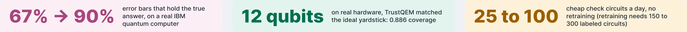
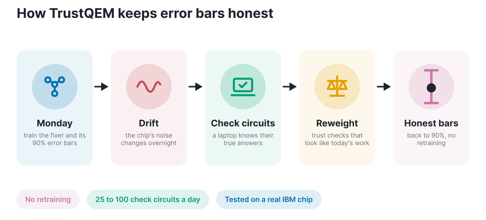
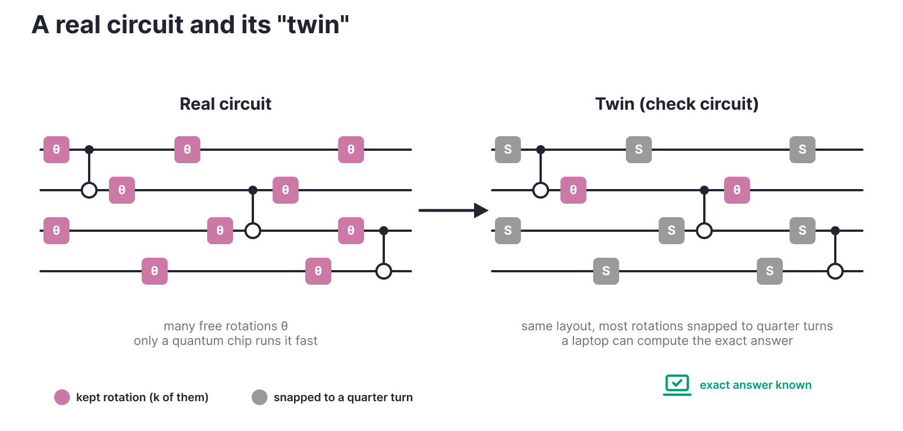
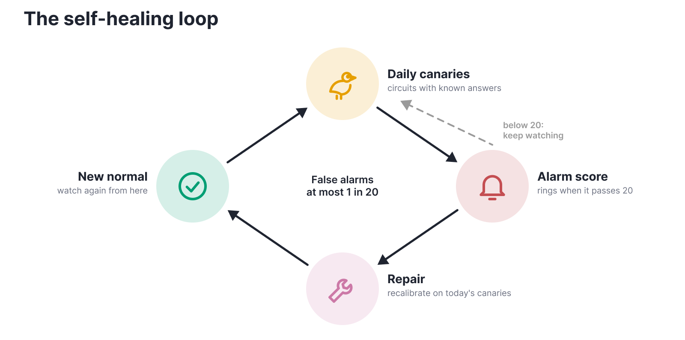

<div align="center">

# TrustQEM

**Quantum error bars that stay honest when the chip drifts.**

[](https://github.com/reddy-nithin/trustqem/actions/workflows/ci.yml)


Hack-A-Roo Fall 2026, Quantum track, UMKC



</div>

## The problem

Quantum computers make errors. A learned model can undo much of the noise (learned error mitigation), but it gives
one number with no error bar. When the chip's noise drifts overnight, that number goes quietly wrong and nothing
warns you.

On a real IBM chip, error bars that promised 90% held the true answer only **67%** of the time the next day.

## How it works



| Step | What happens |
|---|---|
| **Fixer** | Gradient boosting reads each circuit's noisy answer at 1x, 3x and 5x noise (gate folding) and predicts the clean one. |
| **Bar** | Split conformal prediction: the bar's width is the 90th-percentile error on held-out circuits, so 9 in 10 true answers land inside. |
| **Repair** | On a drifted day, run 25 to 100 check circuits, measure today's errors and recompute that percentile. The model is never retrained. |
| **Weighting** | A classifier tells check circuits from real ones, and its odds up-weight the checks that look like real work (weighted conformal, Tibshirani et al. 2019). |

The trick is the check circuits. Each one is a near-Clifford "twin" of a real circuit: same layout, most rotations
snapped to quarter turns. A laptop can compute its exact answer at any size, so we always know how wrong the chip is
today.



## Results on a real IBM quantum computer

**Three sessions on ibm_fez, days apart. Old error bars: 65 to 67%. TrustQEM: back to about 90% every time, with no
retraining. At 12 qubits it matched the ideal yardstick exactly.**


| session (ibm_fez) | no fix | standard (ZNE + bootstrap) | **TrustQEM** (K = 60) | ideal yardstick | TrustQEM width vs ideal |
|---|---|---|---|---|---|
| S1, 4 qubits, Oct 26 | 0.667 | 0.774 | **0.902** | 0.917 | 0.90x |
| S2, 4 qubits, Oct 29 | 0.648 | 0.717 | **0.905** | 0.914 | 0.98x |
| S3, 12 qubits, Nov 8 | 0.675 | 0.789 | **0.886** | 0.886 | 0.98x |

Coverage is the share of test answers inside their 90% error bar (target 0.90). The "ideal yardstick" (oracle) is an
unfair best case that recalibrates on the real test circuits' known answers. Each session has 60 test circuits, so
the 95% intervals are about ±5 points, and all three TrustQEM intervals contain 0.90. The model is trained only on
simulated data, so every session is a real shift from training to hardware.

## Self-healing



Every day about 30 canary circuits with known answers run first. A betting score (a conformal test martingale) grows
when they look worse than the reference day. At 20 the alarm rings, and by Ville's inequality false alarms stay under
1 in 20 however long you watch. On alarm, TrustQEM recalibrates on that day's canaries and watches from the new normal.


Replayed on the hardware sessions in 200 random canary orders, the alarm fired on the first hardware day in 200 of 200
and healed coverage from 0.667 to 0.902. Three days later it stayed quiet, and the old repair still held (0.890). At
12 qubits it fired in 200 of 200 and healed 0.675 to 0.886.

## Scaling, and where it stops


In simulation the repair is complete at 4 qubits, and at 12 qubits under realistic FakeFez chip noise (0.88 to 0.93).
Under strong gate-noise drift at 6 to 12 qubits it is only partial (about 0.81 to 0.85 instead of 0.90): small check
circuits mostly answer exactly 0, and gate noise can't move a 0. A drift alarm on a simulated 156-qubit chip caught
drift in 200 of 200 runs with 0 false alarms, but that tests the alarm only, not the error bars.

## How it differs from prior work

| | Learned mitigation | Error bars | Handles drift |
|---|---|---|---|
| IBM ML-QEM (Liao et al. 2023) | yes | no (future work) | retrains on ~300 circuits |
| AQCP (Spencer et al. 2025) | no (quantum ML) | yes | yes |
| **TrustQEM** | **yes** | **yes** | **yes, no retraining** |

## Limitations

- One chip, three sessions, about ±5 points each.
- Plain unweighted recalibration also restored coverage on the hardware days, so the weighting is not singled out there.
- The alarm catches mild drift only 23 to 63% of the time.
- Error bars are untested beyond 12 qubits, and nothing here is claimed beyond that.

## Research practice

Hypotheses and pass/fail rules were written down before any experiment ran, with every later change logged as a
dated amendment: [docs/HYPOTHESES.md](docs/HYPOTHESES.md). Every pass, partial and fail is in
[docs/RESEARCH_LOG.md](docs/RESEARCH_LOG.md), failures included. Each poster figure is drawn from a committed results
file by [scripts/poster_figures.py](scripts/poster_figures.py).

The three hardware jobs, as listed on IBM Quantum Platform (full job IDs are in each session's `jobs.json`):


<details>
<summary><b>The poster</b> (48 x 36 in)</summary>


</details>

## Quick start

```bash
uv sync
uv run pytest -q
uv run trustqem run drift --profile pilot     # toy noise model, drift by scaling error rates
uv run trustqem run device --profile pilot    # FakeFez noise, gate folding, calibration drift
uv run python scripts/poster_figures.py       # redraw every results figure from its results file
uv run jupyter lab notebooks/
```

Running on a real IBM device (account setup, QPU budget, the six `hardware` steps): [docs/HARDWARE.md](docs/HARDWARE.md).
The three sessions used 435 of the 600 s free Open Plan budget.

## Layout

```
src/trustqem/               circuits, noise models, device model and gate folding, simulation, mitigation,
                            conformal recalibration, drift monitor, plotting
src/trustqem/experiments/   drift, device, hardware, self-healing and scaling experiments
notebooks/                  00_reproduce_baseline: the starting point, reproduced exactly
tests/                      unit tests (fast by default; `pytest -m slow` runs simulations)
docs/                       hypotheses, research log, hardware guide, README images
scripts/                    poster figures, scaling tables, tmux launcher for long runs
results/                    figures and summaries per experiment (raw pickles are not committed)
```

## Baseline

The starting point is Luke Miller's starter notebook #4 (learned error mitigation) from the
[UMKC Quantum Computing Workshop](https://github.com/LukeJamesMiller/Quantum-Computing-Workshop). Running it through
this repo's modules reproduces all seven of its held-out numbers exactly.


## Acknowledgements

The random-circuit recipe, noise model and baseline methods come from Luke Miller's Hack-A-Roo 2026 starter
notebooks. Mentors: Luke Miller (UMKC QSAIC) and Dr. Md Yusuf Sarwar Uddin. Built for the Hack-A-Roo Fall 2026
Quantum track at UMKC.

## License

MIT
