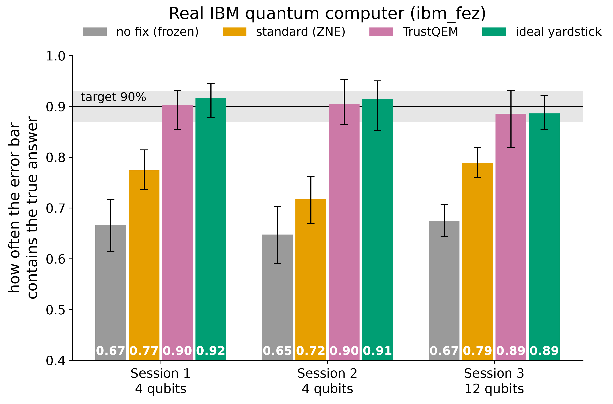
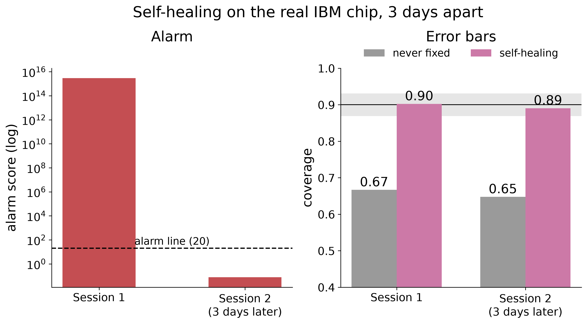
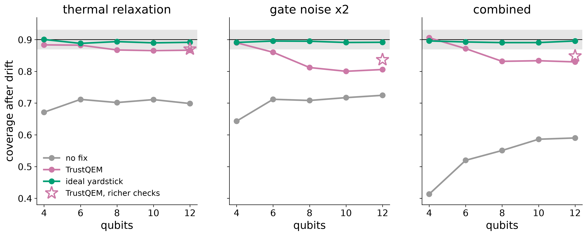
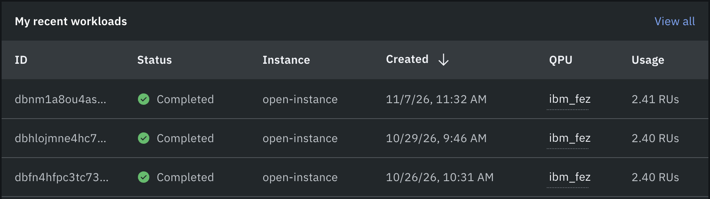

# TrustQEM

[](https://github.com/reddy-nithin/trustqem/actions/workflows/ci.yml)

**Error mitigation that knows when it's wrong.**

Quantum computers are noisy, and error mitigation tries to estimate what a circuit would have returned without
noise. Learned error mitigation (a model trained on noisy/ideal pairs) is accurate, but it returns a single number
with no error bar. When the hardware's noise drifts, as it does from day to day, that number quietly goes wrong.

This project:

1. puts conformal prediction intervals (error bars with a coverage guarantee) on learned error mitigation,
2. measures how those intervals fail when the device noise drifts after training,
3. restores them by recalibrating on Clifford circuits, whose ideal outputs a classical computer can calculate at
   any size, without retraining the model, and
4. checks all of this on a model of a real IBM Heron device (FakeFez) and then on the real device, ibm_fez, in three
   sessions at 4, 4 and 12 qubits, and
5. adds a self-healing loop: a drift alarm on the same check circuits that triggers the recalibration only when the
   device has actually changed.

Hypotheses were written down before any experiment ran: see [docs/HYPOTHESES.md](docs/HYPOTHESES.md).
Progress and findings: [docs/RESEARCH_LOG.md](docs/RESEARCH_LOG.md).

## Results

**On the real IBM chip, the old error bars held the true answer about 67% of the time. TrustQEM's held it 89 to 90%
of the time, the 90% it promises, without retraining the model.**



| session (ibm_fez) | frozen bars | ZNE + bootstrap | TrustQEM (R1W, K = 60) | oracle | TrustQEM width vs oracle |
|---|---|---|---|---|---|
| S1, 4 qubits, Oct 26 | 0.667 | 0.774 | **0.902** | 0.917 | 0.90x |
| S2, 4 qubits, Oct 29 | 0.648 | 0.717 | **0.905** | 0.914 | 0.98x |
| S3, 12 qubits, Nov 8 | 0.675 | 0.789 | **0.886** | 0.886 | 0.98x |

Coverage is the share of test answers inside their 90% error bar (target 0.90). Each session has 60 test circuits,
so the 95% intervals are about ±5 points; all three TrustQEM intervals contain 0.90. The model is trained only on
simulated data, so every session is a real drift from training to hardware.

**Self-healing on hardware.** Replaying the alarm on the sessions in order, it fired on the first hardware day in 200
of 200 random check orders and healed coverage from 0.667 to 0.902; three days later it stayed quiet and the old
repair still held (0.890). At 12 qubits it fired in 200 of 200 and healed 0.675 to 0.886.



**Scaling and its limit.** In simulation the repair is complete at 4 qubits, and at 12 qubits under FakeFez device
noise (0.88 to 0.93). Under strong simulated gate-noise drift at 6 to 12 qubits it is only partial (about 0.81 to
0.85 instead of 0.90): small check circuits mostly answer exactly 0, which gate noise cannot move. A drift alarm on a
simulated 156-qubit chip caught drift in 200 of 200 runs with 0 false alarms, but that tests the alarm only, not the
error bars. Nothing here is claimed beyond 12 qubits.



The three hardware jobs, as listed on IBM Quantum Platform (full job IDs are in each session's `jobs.json`):



Every pass, partial and fail against the pre-registered rules is in [docs/RESEARCH_LOG.md](docs/RESEARCH_LOG.md).

## Quick start

```bash
uv sync
uv run pytest -q
uv run trustqem run drift --profile pilot     # toy noise model, drift by scaling error rates
uv run trustqem run device --profile pilot    # FakeFez noise, gate folding, calibration drift
uv run jupyter lab notebooks/
```

Running on a real IBM device (account setup, QPU budget, the six `hardware` steps): [docs/HARDWARE.md](docs/HARDWARE.md).

## Layout

```
src/trustqem/     circuits, noise models, device model and gate folding, simulation, mitigation, plotting
src/trustqem/experiments/   drift, device, hardware, self-healing and scaling experiments
notebooks/        00_reproduce_baseline: the starting point, reproduced exactly
tests/            unit tests (fast by default; `pytest -m slow` runs simulations)
docs/             hypotheses, research log, hardware guide
scripts/          poster figures, scaling tables, tmux launcher for long runs
results/          figures and summaries per experiment (raw pickles are not committed)
```

## Baseline

The starting point is Luke Miller's starter notebook #4 (learned error mitigation) from the
[UMKC Quantum Computing Workshop](https://github.com/LukeJamesMiller/Quantum-Computing-Workshop). Running it through
this repo's modules reproduces all seven of its held-out numbers exactly.


## Acknowledgements

The random-circuit recipe, noise model and baseline methods come from Luke Miller's Hack-A-Roo 2026 starter
notebooks. Built for the Hack-A-Roo Fall 2026 Quantum track at UMKC.

## License

MIT
